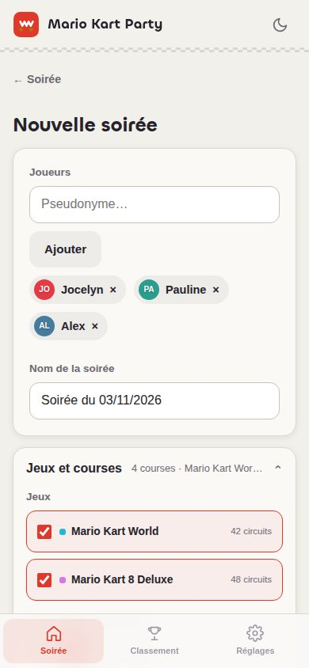
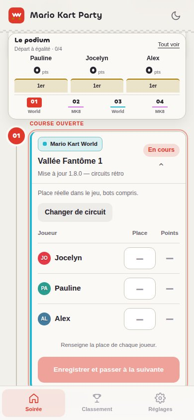
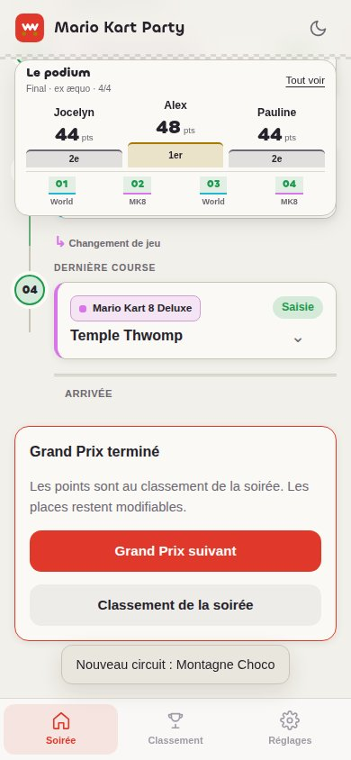

# 🏎️ Mario Kart Party

**PWA locale pour animer vos soirées Mario Kart** : on lance la soirée, les circuits sont tirés au sort, on saisit les places, le classement suit en direct. Tout fonctionne **hors ligne**, **sans compte** et **sans serveur** — vos données restent sur votre appareil.

<p align="center">
  
  
  
</p>

## Sommaire

- [Fonctionnalités](#fonctionnalités)
- [Démarrage rapide](#démarrage-rapide)
- [Déroulé d'une soirée](#déroulé-dune-soirée)
- [Jeux et circuits](#jeux-et-circuits)
- [Vos données](#vos-données)
- [Héberger l'application](#héberger-lapplication)
- [Développement](#développement)

## Fonctionnalités

- **Trois onglets** : Soirée, Classement, Réglages.
- **Soirée en un clic** : les joueurs de la soirée précédente sont présélectionnés, le premier Grand Prix est tiré au sort et démarre tout de suite.
- **Tirage automatique** : jamais deux fois le même circuit dans un GP ; les circuits joués récemment deviennent moins probables, sans être interdits. Un ou plusieurs jeux, éditions et DLC au choix, 2 à 8 courses.
- **Piste du Grand Prix** : les courses défilent sur une piste, un kart marque la course en cours et le classement reste visible dans un bandeau. Les courses saisies se rangent dans un repli.
- **Grille des places** : on touche une place (1 à 12, ou 24 pour Mario Kart World) puis le joueur ; les cases vides sont les bots. La course s'enregistre seule quand tout le monde est placé, avec « Annuler » quelques secondes.
- **Récap de fin de GP** : podium animé, faits marquants (roi des courses, meilleure remontée, course la plus serrée) et classement de la soirée avec les places gagnées ou perdues.
- **Partage du résultat** : une carte au format story (podium, faits marquants, lanterne rouge) et un message prêt à envoyer dans un groupe, qui raconte le GP avec un peu de chambrage.
- **Pas de validation** : chaque course saisie compte immédiatement au classement et reste modifiable.
- **Tirage express** : juste une grille de circuits, sans scores ; chaque circuit se relance individuellement.
- **Classements** : par soirée et tous temps (points, victoires, podiums), ex æquo partagés, export CSV depuis les Réglages.
- **Hors ligne, sans compte, sans serveur** ; export / import JSON.

## Démarrage rapide

Ouvrez `index.html` dans un navigateur — aucune installation, aucun build, aucune dépendance.
Pour installer la PWA, servez le dossier en HTTPS (ou en local) :

```bash
python3 -m http.server 3000
```

## Déroulé d'une soirée

1. **Soirée → Lancer une soirée** : ajustez les joueurs (2 à 12) et, si besoin, « Jeux et courses ».
2. **Lancer la soirée** : le Grand Prix s'ouvre sur la première course.
3. **Placez les joueurs** sur la grille de la course ouverte : la course suivante s'ouvre toute seule. L'icône de relance change le circuit tant que personne n'est placé ; le menu « … » supprime le GP.
4. **Récap** → « Grand Prix suivant » tire une nouvelle grille avec les mêmes réglages.

La soirée la plus récente est affichée sur l'accueil avec son classement ; les précédentes restent consultables.

## Jeux et circuits

**Réglages → Jeux et circuits** : ajoutez un jeu (nom et icône), des éditions (jeu de base, DLC) et des circuits.
L'interrupteur d'un circuit l'exclut des tirages sans le supprimer. Un circuit déjà joué et supprimé disparaît
du catalogue sans modifier les anciens résultats.

**Ajouter des circuits** : collez une liste (un circuit par ligne). Une ligne `== Nom ==` crée ou remplit
une édition, la numérotation est retirée automatiquement. Un fichier txt / csv / json ou une liste préparée
par IA sont proposés en options. Vérifiez l'aperçu, retirez les erreurs, puis Importer.

| Jeu | Contenus préchargés |
|---|---|
| Mario Kart World | 32 circuits + 10 circuits rétro (mise à jour 1.8.0) |
| Mario Kart 8 Deluxe | 32 circuits + 16 circuits (Pass circuits) |

## Vos données

- Stockage **100 % local** (`localStorage`) ; exportez une sauvegarde JSON depuis les Réglages.
- Les données des versions précédentes sont migrées automatiquement (schéma v2) : résultats conservés,
  anciens statuts « Abandon / Absent / Forfait » comptés 0 point.
- Si un autre onglet a enregistré des données plus récentes, l'écriture est bloquée et un export du brouillon est proposé.

## Héberger l'application

N'importe quel hébergement statique convient. Le workflow `.github/workflows/pages.yml` déploie sur
GitHub Pages à chaque push sur `master` (Settings → Pages → Source : GitHub Actions).

## Développement

```
├── index.html            # Coquille (en-tête, 3 onglets)
├── sw.js                 # Service worker (cache hors ligne versionné)
├── css/style.css
├── js/
│   ├── app.js            # Routeur par hash, thème
│   ├── store.js          # Persistance locale, catalogue préchargé, migrations
│   ├── engine.js         # Tirage pondéré, barème, classements (pur, testé)
│   ├── draw.js           # Préférences de tirage, création d'un GP
│   ├── views.js          # Accueil, nouvelle soirée, soirée
│   ├── gp.js             # Grand Prix : piste, grille des places, récap
│   ├── views-admin.js    # Tirage express, jeux, classement, réglages
│   ├── race-visuals.js   # Badges et chronologie
│   ├── updates.js        # Version et mise à jour PWA
│   └── ui.js             # h(), modales, toasts
├── scripts/version.mjs   # Numéro de version unique
└── tests/                # node --test tests/
```

- Tests : `node --test tests/` (Node.js 18+, sans dépendance).
- Publier une version : `node scripts/version.mjs AAAA.MM.JJ.N` met à jour `sw.js`, `js/updates.js`
  et `index.html` ; sans argument, le script vérifie que les trois sont cohérents.

## Sources des listes de circuits

- **Mario Kart World** (lancement) : [guide ActuGaming](https://www.actugaming.net/guide-circuits-mario-kart-world-730586/)
- **Mario Kart World 1.8.0** (10 circuits rétro) : [RetroGems](https://retrogems.fr/mario-kart-world-mise-a-jour/)
- **Mario Kart 8 Deluxe** (48 circuits) : [jeuxvideo.com](https://www.jeuxvideo.com/wikis-soluce-astuces/999277/tous-les-circuits-de-mario-kart-8-deluxe-raccourcis-et-astuces.htm)

## Licence et avertissement

Code sous licence [MIT](LICENSE) — © 2026 Jocelyn Sabatini.

> **Avertissement** : ce projet est un outil communautaire sans lien avec Nintendo. Mario Kart et les noms de circuits sont des marques de Nintendo ; les listes de circuits sont fournies à titre informatif et peuvent contenir des erreurs ; elles restent modifiables dans l'application.
