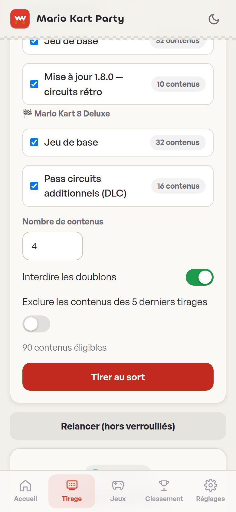
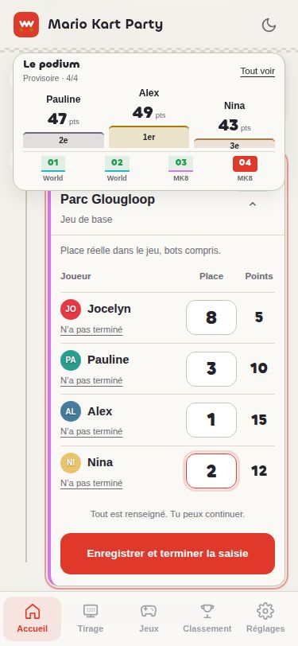
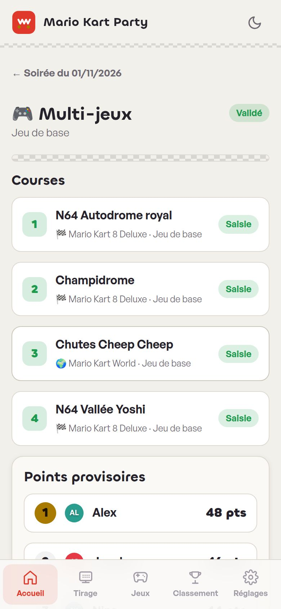

# 🏎️ Mario Kart Party

**PWA locale pour animer vos soirées Mario Kart** : tirages aléatoires de circuits, Grands Prix, saisie des scores, classements et export des données. Tout fonctionne **hors ligne**, **sans compte** et **sans serveur** — vos données restent sur votre appareil.

<p align="center">
  
  
  
</p>

## Sommaire

- [Fonctionnalités](#fonctionnalités)
- [Démarrage rapide](#démarrage-rapide)
- [Guide d'utilisation](#guide-dutilisation)
- [Le catalogue de jeux](#le-catalogue-de-jeux)
- [Vos données](#vos-données)
- [Héberger l'application](#héberger-lapplication)
- [Structure du projet](#structure-du-projet)
- [Sources des listes de circuits](#sources-des-listes-de-circuits)
- [Licence et avertissement](#licence-et-avertissement)

## Fonctionnalités

- **Soirées (sessions)** : créez une soirée, ajoutez vos joueurs (conservés d'une soirée à l'autre), lancez autant de Grands Prix que vous voulez.
- **Tirages aléatoires** :
  - un **ou plusieurs jeux mélangés** (ex. Mario Kart World + Mario Kart 8 Deluxe) ;
  - filtres par édition/extension et par statut de vérification ;
  - **sans doublon** (option), **verrouillage** de circuits favoris et re-tirage du reste ;
  - exclusion des circuits déjà joués (5 derniers tirages) ;
  - historique des tirages.
- **Grand Prix** : 4 courses par défaut (configurable), tirées au sort ou reprises d'un tirage rapide.
- **Saisie des courses** :
  - positions de **1 à 12** — les bots du jeu occupent les places entre les joueurs humains, on peut donc finir 8e à 4 joueurs ;
  - statuts spéciaux : Abandon, Absent, Forfait (0 point) ;
  - détection des conflits (deux joueurs sur la même place) avant validation.
- **Barème modifiable** : 15/12/10/9/8/7/6/5/4/3/2/1 par défaut, éditable dans les réglages.
- **Validation et corrections** : un GP validé verrouille la saisie ; une correction reste possible et est **tracée dans un journal d'audit** (qui a modifié quoi et quand).
- **Classements** : par soirée et toutes soirées confondues (points, victoires, podiums), export **CSV**.
- **Catalogue administrable** : jeux, éditions, circuits — rien n'est figé, tout s'ajoute, se modifie, se désactive ou s'archive ; statut de vérification par contenu (Vérifié / À vérifier).
- **Export / import JSON** : sauvegarde et restauration complètes de toutes vos données.
- **PWA installable** : thème clair/sombre, pensée mobile d'abord, fonctionne hors ligne.

## Démarrage rapide

### Utiliser directement

Ouvrez simplement `index.html` dans un navigateur — aucune installation, aucun build, aucune dépendance.

> **Note** : pour installer la PWA (et l'utiliser hors ligne sur mobile), servez le dossier via HTTPS. Voir [Héberger l'application](#héberger-lapplication).

### En local avec un serveur

```bash
# au choix
python3 -m http.server 3000
npx serve . -l 3000
```

Puis ouvrez http://localhost:3000 et installez l'application depuis le menu du navigateur (« Installer l'application » / « Sur l'écran d'accueil »).

## Guide d'utilisation

### Tirage rapide

Choisissez vos jeux et un format de 2, 4, 6 ou 8 courses (ou un nombre
personnalisé). Le volet **Éditions, DLC et options** permet de choisir le jeu
de base uniquement, d'inclure toutes les éditions actives, et de régler les
doublons et l'exclusion des cinq derniers tirages. Ces préférences sont
mémorisées sur l'appareil.

Après le tirage, les réglages se replient. Utilisez **Garder** pour protéger
une course à sa position, **Changer** pour remplacer une seule course, ou
**Relancer les courses libres** pour refaire le reste. Un changement de
filtres efface les résultats précédents pour éviter de lancer un GP avec
une sélection périmée. Choisissez votre soirée dans le sélecteur, puis
**Lancer le Grand Prix**, ou créez une nouvelle session avec ces courses.

Chaque jeu dispose d'un badge nominatif et d'une couleur cohérente. Les courses
sont reliées dans une chronologie numérotée, du départ à l'arrivée, avec un repère
à chaque changement de jeu. L'écran du Grand Prix affiche la progression des
saisies et un accès direct à la prochaine course incomplète ; les autres courses
restent accessibles pour la saisie ou une correction.

1. **Créez une soirée** — Accueil → « Nouvelle session » → ajoutez au moins 2 joueurs (12 maximum).
2. **Tirez les courses** :
   - depuis la soirée : « Nouveau Grand Prix » — cochez un ou plusieurs jeux, choisissez les éditions, le nombre de courses, puis « Tirer les courses » ;
   - ou depuis l'onglet « Tirage » : tirez, verrouillez vos circuits préférés, relancez le reste, puis « Lancer un Grand Prix » ou « Créer une session avec ce tirage ».
3. **Saisissez chaque course** — pour chaque joueur, touchez sa position d'arrivée (1 à 12) ou son statut (Abandon/Absent/Forfait). Les points s'affichent en direct.
4. **Validez le Grand Prix** — une fois les 4 courses complètes et sans conflit, « Valider le Grand Prix » ajoute les points au classement de la soirée.
5. **Corrigez si besoin** — « Modifier » sur le GP validé : chaque changement est horodaté dans l'historique d'audit.
6. **Consultez les classements** — onglet « Classement » : par soirée ou toutes soirées, export CSV possible.

## Le catalogue de jeux

### Nettoyer un import

Avant de valider l'import, utilisez **Retirer** dans l'aperçu pour écarter
chaque circuit incorrect. La liste et les compteurs sont mis à jour immédiatement.

Après import, ouvrez **Jeux → votre jeu → édition → Supprimer des circuits**.
Recherchez puis cochez les éléments à retirer, ou utilisez **Tout sélectionner
(filtre)**. Cliquez sur **Supprimer la sélection**, puis confirmez.
Les circuits jamais utilisés sont supprimés ; ceux présents dans un Grand Prix
sont archivés et exclus des prochains tirages, sans modifier les anciens résultats.
Vous pouvez annuler avant confirmation et vos choix sont conservés localement
après validation.

Le catalogue préchargé contient :

| Jeu | Contenus | Statut |
|---|---|---|
| Mario Kart World | 32 circuits (jeu de base) + 10 circuits rétro (mise à jour 1.8.0) | Base vérifiée · rétro **à vérifier** |
| Mario Kart 8 Deluxe | 32 circuits (jeu de base) + 16 circuits (Pass circuits) | Vérifié |

Tout est administrable dans l'onglet « Jeux » : ajoutez vos propres jeux/éditions/circuits, marquez les noms à vérifier, désactivez temporairement un circuit qui ne plaît pas à la table.

## Vos données

- Stockage **100 % local** (`localStorage` du navigateur) — aucun compte, aucun serveur, aucune donnée envoyée.
- **Export JSON** (Réglages) pour sauvegarder ou changer d'appareil ; **import JSON** pour restaurer.
- Environnements restreints (iframe d'aperçu) : l'application bascule en mémoire volatile et l'indique par un bandeau.

## Héberger l'application

N'importe quel hébergement statique convient (GitHub Pages, Netlify, Vercel, un simple dossier sur un serveur web…). Le repo inclut un workflow GitHub Actions (`.github/workflows/pages.yml`) :

1. Sur GitHub : **Settings → Pages → Build and deployment → Source : GitHub Actions**.
2. Poussez sur `master` — le site est déployé sur `https://<user>.github.io/Mario-Kart-Party/`.

Tous les chemins de l'application sont relatifs : elle fonctionne aussi bien à la racine d'un domaine que dans un sous-dossier.

## Structure du projet

```
├── index.html            # Coquille de l'application (tabbar, header, thème)
├── manifest.webmanifest  # Manifeste PWA
├── sw.js                 # Service worker (cache hors ligne)
├── css/style.css         # Design system (thème nuit/circuit)
├── js/
│   ├── app.js            # Routeur par hash, thème, enregistrement du SW
│   ├── store.js          # Persistance localStorage + catalogue préchargé
│   ├── engine.js         # Tirage aléatoire, barème, calculs de points
│   ├── ui.js             # Composants UI (h(), modal, toast…)
│   ├── views.js          # Accueil, session, GP, saisie des courses
│   ├── views-admin.js    # Tirage, bibliothèque, classement, réglages
│   └── pending.js        # Passation d'un tirage vers une session
├── icons/                # Icônes PWA (192, 512, maskable)
└── docs/screenshots/     # Captures d'écran du README
```

Aucune dépendance, aucun build : JavaScript natif (ES modules) et CSS.

## Sources des listes de circuits

- **Mario Kart World** (lancement) : [guide ActuGaming](https://www.actugaming.net/guide-circuits-mario-kart-world-730586/)
- **Mario Kart World 1.8.0** (10 circuits rétro) : [RetroGems](https://retrogems.fr/mario-kart-world-mise-a-jour/) — marqués « à vérifier » dans l'app
- **Mario Kart 8 Deluxe** (48 circuits) : [jeuxvideo.com](https://www.jeuxvideo.com/wikis-soluce-astuces/999277/tous-les-circuits-de-mario-kart-8-deluxe-raccourcis-et-astuces.htm)

## Licence et avertissement

Code sous licence [MIT](LICENSE) — © 2026 Jocelyn Sabatini.

> **Avertissement** : ce projet est un outil communautaire sans lien avec Nintendo. Mario Kart et les noms de circuits sont des marques de Nintendo ; les listes de circuits sont fournies à titre informatif et peuvent contenir des erreurs — d'où les statuts de vérification dans l'application.
